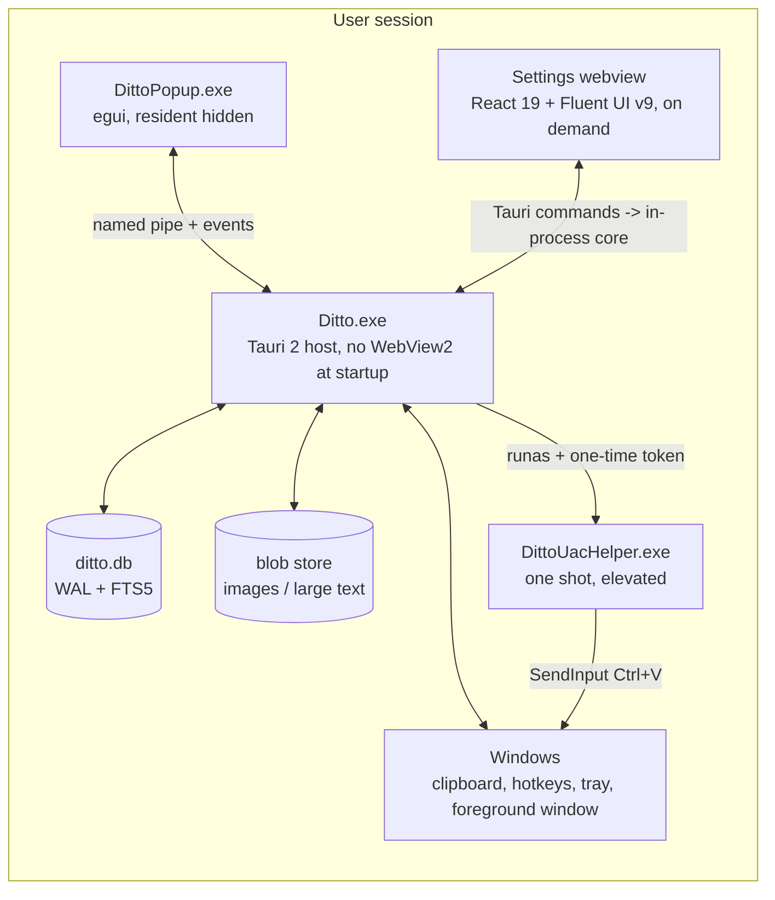

# ARCHITECTURE — Ditto Rust/Tauri rewrite

- Status: **T0 baseline, frozen for T1–T8**
- Date: 2026-11-12
- Base: `master` @ `4719eea`
- Worktree: `rewrite-design` / branch `taohy/rewrite-design`
- Scope: process model, IPC, lifecycle, configuration, security boundaries, fallback plan.
- Non-goals: source code, build scripts, UI implementation. Those are T1+.
- Authority: this document is derived from the coordinator's rewrite prompt and
  the current C++ tree. Where this document conflicts with a later task prompt,
  the coordinator must resolve the conflict explicitly and update this file.

---

## 1. Product constraints (fixed)

| Constraint | Value |
|---|---|
| Platform | Windows 10 1809+ / Windows 11, x64 (arm64 later) |
| Settings UI | **React 19 + TypeScript + Vite + Fluent UI React v9**, inside Tauri 2 WebView2 |
| Popup UI | **egui + winit**, native, resident hidden, pre-warmed |
| Language/Rust edition | Rust stable; **edition decided by T1** (recommended 2024, fallback 2021) |
| Windows-only | No macOS/Linux code paths in v1 |
| Languages | English and Simplified Chinese in v1; i18n architecture for later languages |
| Packaging | Portable ZIP + NSIS installer; **no auto-update in v1** |
| Legacy data | Migrate `Main`/`Data`/`Types`/`CopyBuffers` + mappable `Ditto.Settings`; never modify the originals |
| Legacy add-ins | Not loaded, not ported, not emulated |
| Legacy themes/language XML | Not migrated; new token/locale system |
| Telemetry | None |
| Network | No friends/P2P in v1; CF_HDROP file clipboard and drag/drop are in v1 |
| Idle memory | **< 100 MB** total for the resident processes |
| Popup latency | **p95 < 50 ms** from global hotkey to first presented frame |
| 10k clips | Search < 50 ms, 60 fps scroll, no memory growth (see `PERFORMANCE.md`) |
| License | GPLv3, unchanged (`LICENSE` is read-only) |

The rewrite must not add an unrelated application framework. Tauri 2, egui,
React 19, Fluent UI React v9, SQLite, and small Rust support crates are the
allowed stack. No Electron, no WinUI rewrite, no Qt, no web UI for the popup.

---

## 2. Process model (primary plan)

Three production binaries. The names are stable because the installer,
packaging, firewall rules, and crash reports refer to them.

| Binary | Lifetime | UI | Owns |
|---|---|---|---|
| `Ditto.exe` | Login → exit | None at startup; may host the settings webview on demand | Single-instance lock, SQLite, clipboard capture, global hotkeys, tray, IPC server, settings window, paste engine, migration |
| `DittoPopup.exe` | Login → exit, **resident but hidden** | egui popup only | Popup rendering/input, list virtualization, search field, preview, group flyout, keyboard navigation |
| `DittoUacHelper.exe` | One shot per elevated paste | None | Elevated `SendInput` only; exits immediately |

### 2.1 `Ditto.exe` — core host

- Starts as a **background process**: no window, no WebView2, no taskbar entry.
- Tauri 2 is used as the host/runtime and as the settings-window provider, but
  **no Tauri window or WebView2 instance is created at startup**. The Tauri
  config starts with `windows: []`; the settings window is built at runtime.
- Domain logic lives in `crates/ditto-model`, `ditto-ipc`, `ditto-win`,
  `ditto-clipboard`, `ditto-storage`, `ditto-migration`, `ditto-paste`, and
  `ditto-uac-helper`. `apps/ditto` is a thin Tauri host. **Domain crates must
  not depend on Tauri**, so the fallback host in §3 can reuse them unchanged.
- A hidden message-only window owns:
  - `RegisterHotKey` registrations;
  - `AddClipboardFormatListener` (fallback `SetClipboardViewer`);
  - `Shell_NotifyIcon` tray icon and menu;
  - `WM_QUERYENDSESSION` / `WM_ENDSESSION`;
  - `TaskbarCreated` re-registration.
- SQLite is opened only by this process. No other process opens the database,
  including read-only. This keeps migration, backup, and WAL recovery under one
  owner.
- The settings window is created on demand with `tauri::WebviewWindowBuilder`
  and destroyed on close. It is not hidden-and-kept, because a hidden WebView2
  costs memory and keeps `msedgewebview2.exe` resident.
- The core also spawns and supervises `DittoPopup.exe` (Tauri sidecar) and
  `DittoUacHelper.exe` (on demand).

### 2.2 `DittoPopup.exe` — egui popup

- Started by the core at login and kept **resident but hidden** so the hotkey
  path never pays process-start and font/texture initialization costs.
- Window styles: `WS_EX_NOACTIVATE | WS_EX_TOOLWINDOW`, no taskbar button, no
  activation on show. The popup must not steal focus from the target app until
  the user interacts; keyboard input is captured with the popup's own message
  pump after the explicit hotkey action.
- Renders only the popup. It has no database handle, no clipboard listener, no
  hotkey registration, and no tray icon.
- Talks to the core over the named pipe (§4). It requests search pages, clip
  details, preview blobs, and paste actions.
- Uses `winit` + `egui`/`eframe` in a single UI thread. Blocking work (pipe
  reads, image decode, thumbnail cache) runs on helper threads and delivers
  results through a channel.
- On pipe loss, it acts as the core's watchdog (§5.4).
- The popup is per-session and per-user; it never runs elevated.

### 2.3 `DittoUacHelper.exe` — elevation helper

- Small, separate binary with a minimal dependency surface.
- Launched by the core with `ShellExecuteEx` + `runas` **only when the current
  foreground target is elevated and Ditto is not**.
- The core writes the clipboard payload first. The helper receives a one-time
  token over an authenticated one-shot channel, validates it, waits for a short
  readiness window, sends `Ctrl+V` with `SendInput`, and exits. It does not
  read the user's clipboard history or touch the database.
- If T4 proves that the elevated target cannot read a medium-integrity
  clipboard write, the helper may receive the exact payload over the same
  one-shot channel and write it itself. It still executes no arbitrary
  commands, paths, or scripts. This exception must be documented in T4's
  security notes.
- The legacy `/uacpaste:<pid>` switch is **not** carried forward. See
  `SECURITY.md` §4.

### 2.4 Process diagram



---

## 3. Fallback model (T1 spike decision, re-verified at T7)

The primary plan is accepted only if the T1 spike proves it meets the
idle-memory budget. T1 must measure and record the decision in
`docs/rewrite/PHASE0-NOTES.md`; T7 re-verifies at integration.

| Plan | Resident processes | When |
|---|---|---|
| **A (primary)** | `Ditto.exe` (Tauri host, no webview) + `DittoPopup.exe` | Default |
| **B (fallback)** | `DittoCore.exe` (headless Rust host over the same domain crates) + `DittoPopup.exe`; `DittoSettings.exe` (Tauri) starts on demand and exits on close | If the median idle total is > 100 MB, or Tauri cannot run without WebView2, or startup-to-tray p95 > 2 s |

**T1 spike protocol.** Cold boot, let the system settle, start the core with
`--background`, keep settings closed and the popup hidden, wait 10 minutes,
sample the process-tree working set three times. Median > 100 MB triggers
Plan B. The same protocol is used at T7 (see `PERFORMANCE.md` §3). T1 must
record raw numbers, process counts, and whether any `msedgewebview2.exe`
exists.

**Why Plan B is safe.** Domain crates (`ditto-storage`, `ditto-clipboard`,
`ditto-ipc`, etc.) have no Tauri types. In Plan B, `DittoCore.exe` is a headless
host that wires the same crates; `DittoSettings.exe` is a Tauri client that
connects to the same pipe. If Tauri cannot initialize at all, the fallback must
still build and run; T1 must prove this with a separate binary target or a
feature flag, not a rewrite.

**Packaging.** Both plans ship the same data directory, settings schema, IPC
protocol version, and locale catalogs. NSIS installs the selected plan's
binaries; the portable ZIP must not ship both hosts as resident processes.

---

## 4. IPC protocol

### 4.1 Transport

- Named pipe, byte mode, one instance per user session:
  `\\.\pipe\ditto-<current-user-sid>`, where `<current-user-sid>` is the
  canonical string form of the logged-in user's SID (for example
  `\\.\pipe\ditto-S-1-5-21-...`). The name is stable across restarts so CLI
  clients and the popup can reconnect.
- The SID in the name is an address, not a security boundary. The ACL below is
  the boundary.
- `FILE_FLAG_FIRST_PIPE_INSTANCE` prevents another process from squatting the
  name before the core starts. Combined with the single-instance mutex (§5.3),
  only one core can own the endpoint.
- `PIPE_REJECT_REMOTE_CLIENTS` is mandatory.
- Security descriptor (SDDL):
  `D:P(A;;GA;;;SY)(A;;GA;;;<user_sid>)(A;;GR;;;BA)`
  - `SYSTEM`: full control.
  - Current user SID: full control (needed for read/write and
    `FILE_FLAG_FIRST_PIPE_INSTANCE` reuse).
  - Built-in Administrators: read-only; they cannot inject commands.
  - Everyone else: no access.
- The pipe accepts at most 32 simultaneous connections. Idle clients are
  disconnected after 15 s without a heartbeat.

### 4.2 Client authentication

There are two ways to connect, in order of preference:

1. **Inherited handle.** When the core spawns `DittoPopup.exe`, it duplicates
   the server end of a connected pipe into the child and passes the handle value
   on the command line (`--ipc-handle <n>`). This is not guessable by other
   processes and avoids a secret on disk.
2. **Endpoint file + secret.** Every connected binary may also read
   `%LOCALAPPDATA%\Ditto\v2\run\endpoint.json` (portable:
   `<exe_dir>\Data\run\endpoint.json`). The file is ACL-restricted to the
   current user and contains:

   | Field | Meaning |
   |---|---|
   | `pipe` | `\\.\pipe\ditto-<sid>` |
   | `secret` | 32 random bytes, base64url; constant-time compare |
   | `core_pid` | PID of the core |
   | `started_at` | ISO-8601 UTC |
   | `protocol` | `1` |
   | `nonce` | per-boot random value, for diagnostics only |

   The file is written atomically with user-only ACL and deleted on clean exit.
   This is a same-user trust boundary: another process running as the same user
   can read it. That is accepted; the pipe is not a privilege boundary against
   the user themselves.

Both paths perform a `Hello` handshake. The core verifies
`GetNamedPipeClientProcessId`, queries the image path, and accepts only
`Ditto.exe`, `DittoPopup.exe`, `DittoSettings.exe`, `DittoUacHelper.exe`, or a
path under the install directory. Debug/test builds may set
`DITTO_IPC_ALLOW_ANY=1`; release builds ignore it.

### 4.3 Framing

All integers are little-endian. One frame per message.

| Offset | Size | Field |
|---:|---:|---|
| 0 | 4 | magic `DTP1` (`44 54 50 31`) |
| 4 | 2 | protocol version (1) |
| 6 | 2 | frame type (1 = request, 2 = response, 3 = event, 4 = blob chunk) |
| 8 | 2 | flags (bit 0 error, bit 1 binary payload, bit 2 final blob chunk) |
| 10 | 2 | reserved, must be 0 |
| 12 | 4 | payload length (max 16 MiB) |
| 16 | 8 | request id / event sequence |
| 24 | n | payload |

- Control payloads are UTF-8 JSON. Unknown fields are ignored; fields marked
  `required` must be present. JSON is chosen for debuggability; a binary codec
  is not required for v1 and would complicate cross-language clients.
- Binary payloads are raw bytes; the JSON metadata travels in the preceding
  control frame for that request.
- A malformed frame, oversized frame, or protocol mismatch closes the
  connection with an error response when possible. The server logs the peer
  PID and path, never the payload.
- **No arbitrary commands or paths cross the pipe.** The protocol only exposes
  the fixed message catalogue in §4.5. File paths for backup/import/export are
  chosen in the settings UI and passed as a validated, absolute path only to
  the core's own file dialog flow; they are never executed as shell commands.

### 4.4 Handshake and versioning

1. Client sends `Hello`:
   `{ "type":"Hello", "proto_min":1, "proto_max":1, "client":"popup|settings|cli|uac", "pid":1234, "nonce":"..." }`
2. Server replies `HelloAck`:
   `{ "type":"HelloAck", "proto":1, "core_pid":5678, "session":"...", "schema_version":1, "capabilities":["clipboard","groups","copy_buffers","preview","uac_paste"], "state_rev":42, "theme_rev":7 }`
   or `HelloErr` with a stable error code.
3. The negotiated protocol is `min(proto_max, server_max)` and must be ≥
   `proto_min`; otherwise the client must show an "update required" message.
4. Additive fields are allowed within protocol v1. Removing or changing a field
   requires v2.
5. `schema_version` describes the database, not the pipe. A client with an
   older schema must not write; it may read summaries if the core allows it.

### 4.5 Message catalogue (v1)

The coordinator's required messages are canonical here. Extras are additive.
All responses echo `request_id` and carry either `result` or `error`.

| Group | Message | Result |
|---|---|---|
| Health | `Ping` | `{ "pong": true, "uptime_ms": ..., "state_rev": ... }` |
| Health | `GetState` | `{ "state_rev": ..., "theme_rev": ..., "clipboard_connected": bool, "db_ok": bool, "popup_running": bool }` |
| Clips | `GetClips` | `{ "items": [ClipSummary], "total": n, "took_ms": n, "next_cursor": "..." }` |
| Clips | `GetClip` | `ClipDetail` (text, formats, metadata; blobs by reference) |
| Clips | `Search` | same shape as `GetClips`; `query`, `group_id`, `mode`, `limit`, `cursor` |
| Clips | `Paste` | `{ "ok": true, "mode": "normal|plain|multi", "elevated": bool }` |
| Clips | `SetPinned` | `{ "ok": true, "pin_order": n }` |
| Clips | `MoveToGroup` | `{ "moved": n, "state_rev": n }` |
| Clips | `Delete` | `{ "deleted": n }` |
| Clips | `GetPreview` | blob transfer reference (thumbnail or original) |
| Clips | `EditClip` (extra) | `{ "ok": true, "state_rev": n }` |
| Clips | `CopyClip` (extra) | `{ "ok": true }` |
| Groups | `GetGroups` | `{ "groups": [GroupNode] }` |
| Groups | `CreateGroup` / `RenameGroup` / `DeleteGroup` / `MoveGroup` (extra) | `{ "ok": true, "state_rev": n }` |
| Buffers | `CopyBufferAssign` / `CopyBufferClear` / `CopyBufferPaste` (extra) | `{ "ok": true }` |
| Settings | `GetSettings` | `{ "values": {...}, "revision": n }` |
| Settings | `SetSettings` | `{ "values": {...}, "revision": n, "restart_required": bool }` |
| Popup | `ShowPopup` / `HidePopup` / `TogglePopup` (extra) | `{ "visible": bool }` |
| App | `Shutdown` | `{ "ok": true }` (best effort; the core then exits) |
| App | `OpenSettings` (extra) | `{ "ok": true }` (core creates the webview) |

`Search` / `GetClips` request:

| Field | Type | Notes |
|---|---|---|
| `query` | string | empty = browse |
| `group_id` | int? | null = all, `-1` = ungrouped, `>=0` = group |
| `mode` | enum | `contains`, `wildcard`, `regex`, `fulltext`, `quickpaste` |
| `sort` | enum | `recent`, `oldest`, `pinned_first`, `group_order` |
| `limit` | int | default 200, max 1000 |
| `cursor` | string? | opaque; stable for the current `state_rev` |
| `include_preview` | bool | include `preview_text` in summaries |

`ClipSummary` is deliberately small: `id`, `kind`, `preview_text` (≤ 512
chars), `source_app`, `created_at_ms`, `last_pasted_at_ms`, `pinned`,
`pin_order`, `group_id`, `copy_buffer`, `formats` (names only), `has_image`,
`image_thumb_ref`, `pasted_count`, `state_rev`.

Events (server push, only for clients that subscribe in `Hello`):

| Event | Payload | Coalescing |
|---|---|---|
| `ClipAdded` | `ClipSummary` | no |
| `ClipUpdated` | `{id, fields, state_rev}` | per id, 50 ms |
| `ClipDeleted` | `{ids, state_rev}` | 50 ms |
| `GroupChanged` | `{state_rev}` | 100 ms |
| `SettingsChanged` | `{keys, revision}` | 100 ms |
| `ThemeChanged` | `{theme_rev}` | 100 ms |
| `ClipboardState` | `{connected: bool}` | no |
| `ShowPopup` / `HidePopup` | `{at, monitor, mode}` | no |
| `Shutdown` | `{reason}` | no |
| `Error` | `{code, message, retryable}` | no |

Event delivery is best-effort. Every event carries `state_rev`; a client that
falls behind can call `GetState` and refetch. The core drops the oldest
coalesced events rather than blocking the UI.

### 4.6 Error model

Every error is `{ "code": "DITTO_E_...", "message": "...", "retryable": bool, "details": {...}? }`.
Messages are English diagnostic text; localized text is chosen by the client.
`details` must never contain clip content.

| Code | Meaning | Retryable |
|---|---|---|
| `DITTO_E_BAD_FRAME` | malformed/oversized frame | no |
| `DITTO_E_PROTO` | incompatible protocol version | no |
| `DITTO_E_AUTH` | missing/incorrect secret, bad client image | no |
| `DITTO_E_NOT_READY` | core is starting or migrating | yes |
| `DITTO_E_BUSY` | connection/request limit reached | yes |
| `DITTO_E_NOT_FOUND` | clip/group/slot id does not exist | no |
| `DITTO_E_CONFLICT` | group name or slot conflict | no |
| `DITTO_E_DB` | SQLite failure; details contain the SQLite code only | depends |
| `DITTO_E_CLIPBOARD` | clipboard open/write failed after retries | yes |
| `DITTO_E_ELEVATION` | helper launch/token/validation failed | yes |
| `DITTO_E_CANCELLED` | client or user cancelled | yes |
| `DITTO_E_INTERNAL` | unexpected; logged with a correlation id | yes |

Timeouts: control 5 s, search 10 s, blob 30 s, `Shutdown` 2 s. A timed-out
request returns `DITTO_E_BUSY` with `retryable: true`.

---

## 5. Startup, exit, and crash recovery

### 5.1 Startup sequence

| Step | Action | Budget |
|---:|---|---|
| 1 | Parse CLI; resolve data root and log level | < 20 ms |
| 2 | Acquire single-instance mutex; if held, forward CLI and exit | < 20 ms |
| 3 | Create data directories; open rolling log | < 30 ms |
| 4 | Open SQLite; `PRAGMA quick_check` only on unclean start; run schema migrations | < 300 ms typical |
| 5 | Start IPC server; write `endpoint.json` | < 20 ms |
| 6 | Create message-only window; register hotkeys; add clipboard listener; create tray | < 100 ms |
| 7 | Spawn `DittoPopup.exe` hidden; wait for `HelloAck` | < 700 ms p95 |
| 8 | If `--settings`, open the settings webview after step 7 | on demand |
| 9 | Mark ready; log versions, data root, protocol, schema | < 1 s total to core ready |

No WebView2 process may exist before step 8. T1 must verify this with a process
tree snapshot; it is an acceptance criterion.

### 5.2 Exit sequence

1. User chooses **Exit** (tray or settings). `Shutdown` is accepted.
2. Stop accepting new IPC connections; send `Shutdown` to the popup.
3. Unregister hotkeys; remove the clipboard listener; delete the tray icon.
4. Destroy the settings webview if present.
5. Wait up to 2 s for the popup; terminate it if necessary.
6. `PRAGMA wal_checkpoint(TRUNCATE)`, close SQLite.
7. Delete `endpoint.json`; write clean-shutdown marker; release the mutex.
8. Exit with code 0.

On `WM_QUERYENDSESSION` / `WM_ENDSESSION`, the same flush runs with a 3 s
budget. If the flush cannot finish, the WAL is left intact; the next start
recovers it.

### 5.3 Single instance

- Mutex: `Local\Ditto.SingleInstance.<sid_hash>` (per user session; not
  `Global\`, because two sessions may each run their own Ditto).
- Second launch: connect to the pipe, send the CLI command (`open`, `paste`,
  `settings`, `quit`, `connect`, `disconnect`), print nothing on success, exit
  with code 0.
- If the mutex exists but the pipe does not answer within 2 s, the second
  process treats the core as stale, logs it, and exits with a user-visible
  error. It must **not** kill the existing process or delete the mutex; that
  requires a separate `--repair` action with confirmation.
- Portable instances get a distinct mutex/session name derived from the exe
  path, matching legacy behavior.
- Tauri's single-instance plugin may be used for the Tauri host, but the mutex
  and pipe ownership remain authoritative. The plugin must not spawn a second
  core.

### 5.4 Crash recovery

| Failure | Recovery |
|---|---|
| Popup exits/crashes | Core notices the pipe disconnect, reaps it, and relaunches with exponential backoff (0.5 s, 1 s, 2 s, 4 s, max 3 attempts per 10 min). Hotkeys keep working; the next hotkey retries the spawn. |
| Core exits/crashes | Popup sees the pipe close. After 5 s it tries to spawn `Ditto.exe --background`, at most 3 attempts per 10 min. If the single-instance mutex is held but unresponsive, it shows a non-blocking error and stops retrying. |
| Settings webview crashes | Core destroys the window; the next Settings command creates a new one. No core restart. |
| Helper crashes | One paste fails; the core logs `DITTO_E_ELEVATION` and the user can retry. No retry loop. |
| Database corruption | On unclean start, `PRAGMA quick_check`. If it fails, rename the DB and WAL to `ditto.corrupt.<timestamp>.db`, restore the newest verified backup, and show a dialog with the paths. Never silently delete user data. |
| Stale endpoint file | If `core_pid` is not alive, overwrite it. If the pipe name is owned by another process, fail startup with an explicit error; do not fall back to an unauthenticated pipe. |
| Clipboard listener lost | Re-add on `TaskbarCreated` and after explorer restarts; verify with a periodic liveness check. |

### 5.5 Updates

v1 ships with **no auto-updater**. Updates are manual/installer-driven. The
installer must stop the running core gracefully, replace binaries, and restart
if the user chose auto-start. A future updater must use a signed manifest over
HTTPS and verify the signature before running the installer; see `SECURITY.md`
§7. This is deferred, not forgotten.

---

## 6. Configuration, portable mode, and data locations

### 6.1 Resolution order

1. CLI: `--data-dir <path>`, `--portable`, `--safe-mode`, `--log-level`.
2. Environment: `DITTO_DATA_DIR` (tests and automation only; release builds
   log a warning and ignore it unless `--allow-env-data-dir` is also passed).
3. Portable marker file `portable` next to `Ditto.exe`.
4. Default installed mode.

### 6.2 Locations

| Mode | Data root | Notes |
|---|---|---|
| Installed | `%LOCALAPPDATA%\Ditto\v2\` | DB, blobs, thumbs, logs, crashes, run state |
| Portable | `<exe_dir>\Data\` | Same layout; the `portable` marker stays next to the exe |
| Tests | `%TEMP%\ditto-test-<random>\` via `DITTO_DATA_DIR` | Synthetic fixtures only; never the real profile |

`%LOCALAPPDATA%` is chosen over `%APPDATA%` on purpose: SQLite WAL, thumbnails,
and blobs are machine-local, large, and must not roam. Legacy data in
`%APPDATA%\Ditto\` is read-only during migration. A user who wants roaming can
use portable mode on a synchronized folder at their own risk; the docs must
say so.

### 6.3 Data root layout

```
Data\
  ditto.db
  ditto.db-wal
  ditto.db-shm
  blobs\aa\bb\<sha256>.<ext>
  thumbs\<sha256>-<w>.webp
  backups\ditto.<utc>.db
  logs\Ditto.log, Ditto.1.log ... Ditto.4.log
  crashes\
  run\endpoint.json          (deleted on clean exit)
  state.json                 (last clean shutdown, schema, install id)
  config.json                (bootstrap only; see §6.4)
```

`config.json` is deliberately tiny and non-critical: UI/behavior settings live
in SQLite. It holds only values needed before SQLite opens:

| Key | Example | Purpose |
|---|---|---|
| `data_root` | `"C:\\Users\\me\\AppData\\Local\\Ditto\\v2"` | absolute path, diagnostics |
| `portable` | `true` | mirrors marker for diagnostics |
| `last_run_version` | `"2.0.0"` | upgrade detection |
| `schema_seen` | `3` | pre-open sanity check |

If `config.json` is missing or corrupt, the core recreates it from defaults and
logs a warning. It must never block startup.

### 6.4 Settings storage

- Application settings: SQLite `settings` table, one row per key, JSON value,
  `updated_at`. Typed accessors live in `ditto-storage`/`ditto-model`; the
  webview and popup never read SQLite directly.
- Secrets: none in v1. The legacy network password is not migrated because the
  network features are out of v1 scope. If a future version adds them, use
  DPAPI (`CryptProtectData`, current user) and store only ciphertext.
- Settings changes are validated by the core, written in a transaction, and
  broadcast as `SettingsChanged`. Invalid values are rejected with
  `DITTO_E_CONFLICT` and do not partially apply.
- Some settings are **restart-required** (language pack, data directory,
  autostart path). `SetSettings` returns `restart_required: true`; the UI must
  say so. The core must not silently restart itself.
- The settings webview uses React 19 + TypeScript + Vite + Fluent UI React v9.
  It talks to the core through Tauri commands. Each command is a thin typed
  wrapper around one IPC/core call; there is no SQL, no filesystem access, and
  no network access from the webview. Tauri's capability allow-list must expose
  only the settings command namespace and window controls.

### 6.5 Auto-start

- Per-user registry value:
  `HKCU\Software\Microsoft\Windows\CurrentVersion\Run` → `Ditto` =
  `"<install_dir>\Ditto.exe" --background`.
- No Windows service, no scheduled task, no admin rights.
- Installer default: checked, with an explicit "Run Ditto when Windows starts"
  task. Portable default: off, because a portable app should not silently
  create a startup entry; the settings toggle remains.
- The settings page reads/writes the same value and shows the effective path.
  If the value points to a stale path, the page offers to repair it.
- `--background` suppresses any first-run dialog; the tray icon is the only
  visible surface.

---

## 7. Tray, hotkeys, and clipboard

### 7.1 Tray

- One icon in the notification area. Left click toggles the popup; right click
  opens the menu.
- Menu (localized, English/Chinese): Open Ditto, Settings, Connect/Disconnect
  clipboard, Groups submenu, Copy Buffers submenu, Pause capture, Exit.
- The icon is created by the core, not the popup. If Explorer restarts, the
  core re-adds it on `TaskbarCreated`.
- The tray tooltip shows state: "Ditto — connected", "Ditto — paused",
  "Ditto — database error". State is never color-only.

### 7.2 Hotkeys

- Registered with `RegisterHotKey` in the core's message-only window.
- Default open hotkey: `Ctrl+\`` (legacy value `704`, i.e. `MOD_CONTROL |
  MOD_NOREPEAT | VK_OEM_3`). Preserve it for upgraders.
- First ten: `Ctrl+1`..`Ctrl+0` by default, configurable. A registration
  conflict is reported in Settings with the conflicting app if it can be
  identified; the user must rebind. The core must not install a low-level
  keyboard hook as a silent fallback.
- Copy buffers: copy/paste/cut hotkeys per slot (5 slots), unbound by default.
- Per-clip global hotkeys and move-to-group global hotkeys are **deferred** in
  v1 (see `FEATURE-MATRIX.md`); the data model keeps the columns for migration
  so no information is lost.
- Hotkey display uses the user's keyboard layout and the standard Windows
  notation (Ctrl, Shift, Alt, Win).

### 7.3 Clipboard capture

- Preferred API: `AddClipboardFormatListener` on the hidden window. Fallback
  for older builds: `SetClipboardViewer` chain, re-linked after explorer
  restarts.
- On `WM_CLIPBOARDUPDATE`, debounce 20–50 ms, then retry `OpenClipboard` up to
  5 times with 10 ms backoff. Never block the UI thread.
- A capture worker enumerates formats, reads raw bytes, enforces the maximum
  clip size, computes the content hash, deduplicates, and writes a transaction.
- When Ditto itself writes the clipboard (paste or copy), it records the
  expected hash and ignores the resulting notification. This prevents feedback
  loops and duplicate clips.
- Format fidelity is a requirement: raw bytes for every supported format are
  preserved, plus a derived `text/preview` and a thumbnail for images. See
  `DATA-MODEL.md` §4.
- Pause/Disconnect stops capture but keeps the process, tray, and hotkeys
  alive. The state is persisted across restarts (legacy behavior).

### 7.4 Paste

1. Popup sends `Paste` with the clip id, mode, and the foreground window
   handle it saw when it was shown.
2. Core validates that the target is still the foreground window; if not, it
   returns `DITTO_E_CLIPBOARD` unless the user explicitly chose "paste anyway".
3. Core writes the requested formats to the clipboard in the original order,
   then sends `Ctrl+V` with `SendInput`. Plain-text mode writes only
   `CF_UNICODETEXT`; multi-paste writes the joined text.
4. If the target is elevated and the core is not, the core launches
   `DittoUacHelper.exe` with a one-time token and waits up to 10 s. The helper
   sends `Ctrl+V` and exits.
5. Optional clipboard restore: after a configurable delay, the previous
   clipboard contents are restored. This must be a separate, best-effort step
   and must not block the paste.
6. The paste result is broadcast as `ClipUpdated` and the popup updates the
   pasted indicator without a refetch.

### 7.5 Group and copy-buffer semantics

- Groups are a tree. The popup breadcrumb shows the current path; a group
  flyout provides "All clips", "Ungrouped", the tree, and "New group…".
- Ungrouped is a virtual group, not a row in the database.
- Copy buffers are five slots (legacy-compatible; v1 acceptance requires at
  least three). Assigning a clip to a slot stores a reference; pasting a slot
  writes that clip; cutting copies then deletes according to the legacy rules.
  Slot contents survive restart.
- Pinned clips sort before unpinned clips within a group. The sort order is
  stable and uses a fractional `pin_order` so a single-row update is enough.

---

## 8. Settings window lifecycle

- Created on the first Settings command or tray **Settings** click; destroyed
  on window close, not hidden.
- While open, it is a normal Fluent window with a native frame and optional
  Windows 11 Mica backdrop. If Mica is unavailable, use the solid surface
  token. No custom-drawn title bar is required.
- The webview is a pure view: it renders `GetSettings`, sends validated
  `SetSettings`, and subscribes to `SettingsChanged`/`ThemeChanged`. It must
  remain usable if the pipe reconnects; a banner shows "Reconnecting…" and
  disables writes.
- Closing the window frees the WebView2 process tree. The core should verify
  that no `msedgewebview2.exe` child remains after 5 s; if one is stuck, log it
  (do not kill unrelated WebView2 processes).
- If WebView2 is missing or fails to initialize, the core shows a native error
  with a link to the Evergreen runtime and the log path. The popup and core
  continue to work; only Settings is unavailable. This is a hard requirement.
- The settings window is not the history browser for daily use. A compact
  history/search/preview/edit table lives on the **Data** page for management
  tasks; the popup remains the primary fast path.

---

## 9. Logging, diagnostics, and privacy

- Structured logs via `tracing` with a rolling file appender:
  `Data\logs\Ditto.log` plus four rotated files, 5 MiB each.
- Default level `info`; `debug` is opt-in from Settings or `--log-level debug`.
- Every IPC request logs `request_id`, method, duration, result code, and peer
  PID. Payloads are not logged.
- Never log clip text, clipboard bytes, image data, search queries, or window
  titles. Clip ids and content hashes are allowed for correlation.
- Redact `%USERPROFILE%` and other user-identifying path prefixes in release
  logs. Keep full paths only in debug logs, and say so in the settings UI.
- Crash handling: a top-level panic hook logs the panic location and a
  correlation id, then writes a minidump to `Data\crashes\` using
  `MiniDumpWriteDump`. No admin rights. Dumps are opt-in for sharing.
- Diagnostics bundle (user-triggered): versions, OS build, schema version, DB
  stats (counts and sizes), settings with secrets removed, logs, and process
  memory. No clip content. The user sees the file list before it is created.
- No telemetry, no analytics, no network calls in v1. The only outbound
  connection would be a future user-initiated update check; it is deferred.

---

## 10. Build and packaging shape (owned by T1/T6, fixed here)

```
install_dir\
  Ditto.exe                 Tauri core host
  DittoPopup.exe            egui popup (Tauri sidecar)
  DittoUacHelper.exe        elevation helper (sidecar)
  WebView2Loader.dll        only if Tauri requires the loader at startup
  locales\en-US\, zh-CN\    shared locale catalogs
  themes\                   token presets, HC metadata
  icons\
  LICENSE
```

- Tauri 2 config: `windows: []` at startup; settings window created at runtime.
  Tray, global-shortcut, autostart, single-instance, and log plugins are
  configured by T1.
- `DittoPopup.exe` and `DittoUacHelper.exe` are Tauri sidecars so the
  installer/portable layout stays predictable. Sidecar paths must be resolved
  relative to the install directory, never the current working directory.
- The installer must not depend on the VC++ redistributable if the Rust
  toolchain produces a static CRT; if any dependency remains, the NSIS script
  must install it. T1 must verify with a clean Windows VM.
- Portable mode must run from a read-only directory for the binaries, with the
  `Data` folder writable. It must not require the installer, registry, or admin.
- The legacy `Addins` and `Language` DLL/XML layouts are not part of the new
  install. Migration reads language/theme files only if needed for display
  names; it never loads them as code.
- `LICENSE` remains GPLv3 and is installed next to the binaries. The About page
  shows the license and the source URL.

---

## 11. Architecture acceptance criteria

T1–T7 must produce evidence for each:

1. No `msedgewebview2.exe` (or any WebView2 child) is spawned by
   `Ditto.exe --background` at startup; verified with Process Explorer or a
   process-tree snapshot.
2. Settings open/close creates and destroys the WebView2 tree; memory returns
   to within 5 MB of the pre-open value.
3. Hotkey → popup first frame p95 < 50 ms over 100 samples, measured by the
   harness in `PERFORMANCE.md`.
4. Idle total working set median < 100 MB over three cold-boot samples.
5. The popup and settings clients reconnect after a forced core restart without
   user action; no duplicate clips after reconnect.
6. The pipe rejects a non-allow-listed client, a remote client, and a wrong
   secret; the rejection is logged without payload.
7. A second launch forwards its command to the running core and exits within
   150 ms.
8. A crash during a DB transaction leaves a recoverable WAL; the next start
   succeeds and `PRAGMA quick_check` passes.
9. The fallback Plan B can be built and run from the same domain crates without
   source changes outside the host crate (proved by a build target in T1/T7).
10. WebView2 absence produces a native, actionable error; the popup still
    opens and pastes.

---

## 12. Open items delegated downstream

| Item | Owner | Default if unresolved |
|---|---|---|
| Rust edition 2024 vs 2021 | T1 | 2024 if `cargo`/MSVC stable is green; otherwise 2021 |
| Exact Tauri host wiring / plugin versions | T1 | `apps/ditto`, domain crates as listed in §2.1 |
| Primary vs fallback (A/B) | T1 spike, T7 re-verify | Primary A unless measured > 100 MB |
| Mica/Acrylic on settings | T5 | Mica on Win11, solid on Win10 |
| Settings window default size | T5 | 900×640 logical, min 720×480 |
| Whether to ship 30 legacy languages | T6 | EN + ZH only in v1; other catalogs are a later task |
| Updater | T8 | Manual installer in v1; signed updater later |
| Network friends/send | Coordinator | Out of v1 |
| Per-clip global hotkeys / move-to-group hotkeys | Coordinator | Deferred in v1; columns preserved for migration |

---

## 13. Evidence and references

Legacy facts in this document were derived from the current C++ tree at
`master` @ `4719eea`:

- `src/CP_Main.cpp` — `InitInstance`, command line, single-instance mutex,
  UAC helper launch, hotkey/tray/copy-thread startup.
- `src/MainFrm.cpp` — hidden main frame, tray commands, copy-buffer hotkeys.
- `src/CopyThread.cpp`, `src/ClipboardViewer.cpp` — clipboard listener and
  capture pipeline.
- `src/ProcessPaste.cpp`, `src/OleClipSource.cpp`, `src/ExternalWindowTracker.cpp`
  — paste and target-window handling.
- `src/UAC_Thread.cpp`, `src/UAC_Helper.cpp` — legacy elevation behavior.
- `src/Options.cpp` — settings file, registry fallback, paths, defaults.
- `src/MultiLanguage.cpp`, `Debug/Language/*.xml` — language file model.
- `src/DatabaseUtilities.cpp`, `src/Clip.cpp` — database creation, legacy
  schema, dedupe CRC, `Main`/`Data`/`Types`/`CopyBuffers`.
- `src/QPasteWnd.cpp`, `src/QListCtrl.cpp` — popup behavior to preserve.
- `DittoSetup/DittoSetup_10.iss` — install layout, startup registry, payload.
- `docs/ui/CURRENT-STATE.md`, `docs/ui/DESIGN-SYSTEM.md` — prior UI audit and
  approved visual tokens.
- `CLAUDE.md` (repository root, untracked in the base worktree) — build,
  lifecycle, data layer, and editing conventions.
- Coordinator rewrite prompt `ORCA_TAURI_REWRITE_PROMPT.md` — confirmed
  decisions, default assumptions, DAG, and ownership matrix.

Related docs: `DESIGN-SYSTEM.md`, `DATA-MODEL.md`, `FEATURE-MATRIX.md`,
`PERFORMANCE.md`, `SECURITY.md`, `RISK-REGISTER.md`, `OWNERSHIP.md`,
`DECISIONS.md`.
